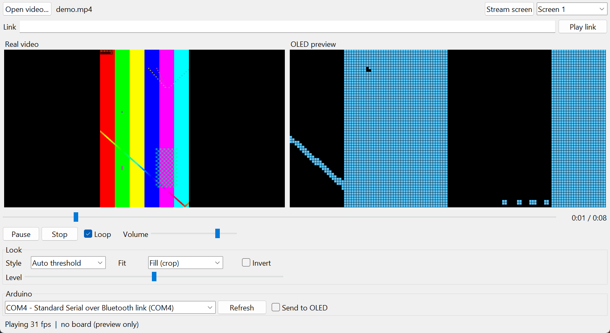

# Arduino OLED Video Player

Play any video, YouTube link, or your live PC screen on a tiny 128×64 OLED connected to an Arduino Nano. The sound plays from your PC, in sync with the picture.



## Features

- **Any video file**: mp4, mov, mkv, webm, gif and more.
- **Links**: paste a YouTube link (Instagram and TikTok usually work too) and press **Play link**.
- **Live screen**: mirror your whole screen, or just the area around the mouse.
- **Sound on the PC**, kept in sync, with pause, seek, loop and volume.
- **Side-by-side view**: the real video in color next to a pixel-exact preview of the OLED.
- **Looks**: Threshold, Auto threshold, Dither, or Outline, plus invert, a level slider, and fit, fill or stretch.
- **Reliable streaming**: every frame has a start marker and checksum, so damaged frames are skipped instead of showing garbage. The Nano also reconnects to the display on its own if it gets stuck.

Speed is about 18–20 fps on the OLED, which is limited by the display's I2C bus. The video in the app plays at full speed.

## Hardware

- Arduino Nano (official or clone; FTDI and CH340 USB chips both work)
- 128×64 I2C OLED with 4 pins: SSD1306 (most 0.96" boards) or SH1106 (most 1.3" boards)

| OLED pin | Nano pin |
|---|---|
| GND | GND |
| VCC | 5V |
| SCL | A5 |
| SDA | A4 |

## Setup

### 1. Upload the sketch to the Nano

Open `OledStream/OledStream.ino` in the [Arduino IDE](https://www.arduino.cc/en/software) and choose:

- **Board:** Arduino Nano
- **Processor:** ATmega328P (try **ATmega328P (Old Bootloader)** if the upload fails, which is common on clones)
- **Port:** your Nano's COM port

Then click Upload.

### 2. Install the PC app

You need [Python 3.10+](https://www.python.org/downloads/). Then run:

```bash
pip install -r requirements.txt
```

YouTube links also need [Node.js](https://nodejs.org/), because yt-dlp uses it to read YouTube pages. You don't need to install ffmpeg separately; it comes with the `imageio-ffmpeg` package.

### 3. Run it

Double-click **`OLED Video Player.bat`** (Windows), or run:

```bash
python oled_player.py
```

Pick your Nano's port at the bottom of the window, then open a video, paste a link, or click **Stream screen**.

## Troubleshooting

| Problem | Fix |
|---|---|
| Nano's LED keeps blinking | The display wasn't found. Check the wiring; SDA and SCL are often swapped. |
| Random dots or a strip of noise on one edge | You have an SH1106 display. Set `COL_OFFSET` to `2` in the sketch and re-upload. |
| "Could not open COMx" | Close the Arduino IDE Serial Monitor (only one program can use the port). |
| Glitchy picture | Make sure `I2C_SPEED` is `400000`. `800000` is faster but some displays can't keep up. |
| A link won't download | Update the downloader with `pip install -U yt-dlp`. Some Instagram posts need you to be logged in. |

## How it works

`oled_player.py` decodes the video with OpenCV, shrinks each frame to 128×64 and turns it into black and white. It then packs the pixels into the display's memory layout: 8 pages × 128 columns, 1 bit per pixel, 1024 bytes per frame.

The Nano sends `R` whenever it's ready for a frame. The PC answers right away with a frame it has already prepared:

```
0xAA 0x55 | 1024 bytes of pixels | 1 byte XOR checksum
```

The serial link runs at 1,000,000 baud. The Nano writes each good frame to the OLED over I2C and replies `!` for a damaged one. The sound is taken from the video with ffmpeg and played with pygame, using the same clock as the picture.

## Files

| File | What it is |
|---|---|
| `oled_player.py` | The PC app (Tkinter) |
| `OledStream/OledStream.ino` | The Arduino Nano sketch |
| `OLED Video Player.bat` | Windows launcher |
| `requirements.txt` | Python packages |

## License

[MIT](LICENSE). You're free to use, change, and share this project.
